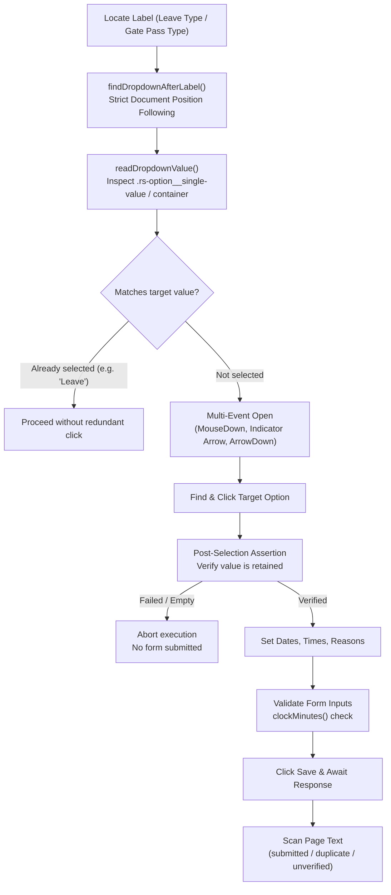
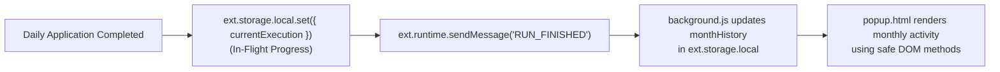

# CAMU AutoPass – Version 1 (V3.7)

A cross-browser Manifest V3 extension (Chrome, Firefox, Safari, and Chromium/Gecko/WebKit-based browsers) for scheduled (Tuesday or Thursday) automation of **three separate daily applications** (Friday, Saturday, Sunday). Each daily form includes the Weekend leave and the integrated Weekend gate pass, so the expected total is **three form submissions**, not six.

---

## 📦 Direct ZIP Downloads (Releases)

You can download the pre-packaged extension ZIP directly from the GitHub Releases page without needing git or Node.js:

| Release | Compatibility | Direct Download |
| :--- | :--- | :--- |
| **v3.7.0 (Chrome)** | **Chrome, Edge, Brave, Opera** (Thursday/Tuesday Default, Week End Gate Pass Fix, Dropdown Failure Tracking) | [Download camu-autopass-chrome-v3.7.0.zip](https://github.com/MSN-2007/WeCam/releases/download/v3.7.0/camu-autopass-chrome-v3.7.0.zip) |
| **v3.7.0 (Firefox)** | **Firefox, Zen, LibreWolf, Floorp** (Gecko MV3 Event Page) | [Download camu-autopass-firefox-v3.7.0.zip](https://github.com/MSN-2007/WeCam/releases/download/v3.7.0/camu-autopass-firefox-v3.7.0.zip) |
| **v3.7.0 (Universal)** | **All Browsers** (Chrome, Firefox, Safari) | [Download camu-autopass-v3.7.0.zip](https://github.com/MSN-2007/WeCam/releases/download/v3.7.0/camu-autopass-v3.7.0.zip) |
| **v3.6.0 (Chrome)** | **Chrome, Edge, Brave, Opera** (Native Background Connect & Auto-Close) | [Download camu-autopass-chrome-v3.6.0.zip](https://github.com/Rish3666/WeCam/releases/download/v3.6.0/camu-autopass-chrome-v3.6.0.zip) |
| **v3.6.0 (Firefox)** | **Firefox, Zen, LibreWolf, Floorp** (Gecko MV3 Event Page) | [Download camu-autopass-firefox-v3.6.0.zip](https://github.com/Rish3666/WeCam/releases/download/v3.6.0/camu-autopass-firefox-v3.6.0.zip) |
| **v3.6.0 (Universal)** | **All Browsers** (Chrome, Firefox, Safari) | [Download camu-autopass-v3.6.0.zip](https://github.com/Rish3666/WeCam/releases/download/v3.6.0/camu-autopass-v3.6.0.zip) |
| **v3.5.0 (Cross-Browser)** | **Chrome, Firefox, Safari** (Pre-Native Connect) | [Download camu-autopass-v3.5.0.zip](https://github.com/Rish3666/WeCam/releases/download/v3.5.0/camu-autopass-v3.5.0.zip) |
| **v3.4.0 (Pre-Firefox)** | **Chrome only** (Original MV3) | [Download camu-autopass-v3.4.0.zip](https://github.com/Rish3666/WeCam/releases/download/v3.4.0/camu-autopass-v3.4.0.zip) |

All releases with changelogs and assets are available on the [GitHub Releases page](https://github.com/Rish3666/WeCam/releases) (and upstream [MSN-2007/WeCam Releases](https://github.com/MSN-2007/WeCam/releases)).

---

## Defaults
- **Time zone**: Asia/Kolkata
- **Allowed execution window**: Selected schedule day (**Thursday** or **Tuesday**), 09:00–23:00
- **Scheduler default**: Thursday 09:05 (Automation enabled by default)
- **Target portal**: `https://student.camu.in/v2/leaveManagement` (v1 also supported via popup selector)
- **Daily leave & gate-pass timing**: 06:00–20:00 (same day for each application)
- **Leave type**: Leave (fixed; CAMU dropdown option)
- **Gate pass type**: `Week End Gate Pass`
- **Gate pass reason**: Weekend outing
- **Documents uploaded**: None

---

## Installation Guide

### Chrome & Chromium-based Browsers (Chrome, Brave, Edge, Opera, Vivaldi)
1. **Download the ZIP**: Download `camu-autopass-chrome-v3.7.0.zip` (or `camu-autopass-v3.7.0.zip`) from the table above and extract it into a folder.
2. Open `chrome://extensions` in your browser.
3. Enable **Developer mode** (toggle in the upper-right corner).
4. Click **Load unpacked** and select the unzipped extension directory.
5. Sign in to CAMU in the same Chrome profile.
6. Click the extension icon in your toolbar, configure your schedule, and click **Save settings**.

### Firefox & Firefox-based Browsers (Firefox, LibreWolf, Zen, Waterfox, Floorp)
1. **Download the ZIP**: Download `camu-autopass-firefox-v3.7.0.zip` (or `camu-autopass-v3.7.0.zip`) from the table above and extract it into a folder.
2. Open `about:debugging` in Firefox.
3. Click on **This Firefox** in the left sidebar.
4. Under the **Temporary Extensions** section, click **Load Temporary Add-on…**.
5. Select the `manifest.json` file inside the unzipped folder.
6. Sign in to CAMU in the same Firefox profile.
7. Click the extension icon in your toolbar, configure your schedule, and click **Save settings**.

### Safari (macOS & iOS)
Safari uses Apple's native App Extension wrapper. A pre-configured Xcode project is included in `safari/CAMU AutoPass/`:

1. Open Safari -> **Settings** (or **Preferences**) -> **Advanced** tab -> Check **Show features for web developers**.
2. In Safari's menu bar, open **Develop** -> Check **Allow Unsigned Extensions** (enter macOS password when prompted).
3. Open and run the project:
   ```bash
   open "safari/CAMU AutoPass/CAMU AutoPass.xcodeproj"
   ```
   Or build from the terminal using the helper script:
   ```bash
   ./scripts/build-safari.sh
   ```
4. In Xcode, select the **CAMU AutoPass (macOS)** scheme and press **Run** (`Cmd + R`).
5. In Safari, open **Settings** -> **Extensions** and check the box next to **CAMU AutoPass**.
6. When prompted, select **Always Allow on Every Website** (or grant permissions for `student.camu.in`).
7. Sign in to CAMU and access the extension from the Safari toolbar!

---

## Execution Modes & Behavior

### 1. Scheduled Automation (Tuesday or Thursday)
- The extension registers an alarm via `chrome.alarms` checking once every minute.
- Runs on the selected schedule day (**Tuesday** or **Thursday**, configurable in the popup) between **09:00 and 23:00 Asia/Kolkata**, at or after the configured start time (default `09:05`).
- The browser must be running and the machine awake during the execution window.
- When triggered, it opens a non-active background tab (`active: false`), completes all three applications, records history, and automatically closes the tab.
- To prevent duplicate runs, it records `lastAttemptDate` per date.

### 2. Manual "Run now" Trigger
- Clicking **Run now** from the popup initiates the full three-day workflow immediately in a background tab without requiring CAMU to be already open in your foreground tab.
- Manual runs calculate the upcoming Friday–Sunday weekend dynamically.
- The tab executes silently and automatically closes upon completion or failure.

---

## 🔍 How Form Filling & Verification Works

The extension applies strict, defensive validation to prevent partial or erroneous submissions:



### 1. Dropdown Scoping & Multi-Selection Calibration
- **Forward-Only Target Discovery (`findDropdownAfterLabel`)**: Uses DOM relative position ordering (`Node.DOCUMENT_POSITION_FOLLOWING`). This guarantees that `Gate Pass Type` resolves strictly to the dropdown control rendered *after* its label, eliminating cross-field collisions with preceding `Leave Type` controls.
- **Direct Dropdown Reading (`readDropdownValue`)**: Extracts text directly from React-Select's `.rs-option__single-value`, `.rs-option__value-container`, or native inputs, disregarding placeholder strings (`"select"` / `""`).
- **Pre-Selected Option Pass-Through**: If CAMU already pre-selects the expected default (e.g., `"Leave"`), the extension avoids unnecessary clicks that might deselect or fail to find options in dynamic menus.
- **Multi-Trigger Menu Opening**: If an option needs selection, the script attempts step-by-step triggers (single click on control, click on indicator arrow, keyboard `ArrowDown`, and searchable input typing) and stops as soon as options appear, avoiding accidental double-toggle closures.
- **Dropdown Failure Handling**: If a dropdown fails to open or match (for example, after a CAMU portal UI update), the run is marked **`failed`**. For the first 3 failed attempts, the popup prompts you to reload the extension and retry; after more than 3 consecutive failed attempts, it links directly to the [GitHub Releases page](https://github.com/MSN-2007/WeCam/releases) to check for updates. The failure counter resets automatically after a successful run.

### 2. Input Simulation & React State Synchronization
- **Native Setter Dispatch**: Uses `Object.getOwnPropertyDescriptor(HTMLInputElement.prototype, 'value').set` to bypass React synthetic event suppression when entering dates and reasons.
- **Semantic Time Validation (`clockMinutes`)**: Formats and parses `06:00` and `20:00` into minutes from midnight, asserting that CAMU's time inputs (`Frtm`, `ToTm`) match the exact configured minutes. If mismatched, execution halts immediately before saving.

### 3. Submission Verification
- After clicking **Save**, the script pauses 2.5 seconds to await the network roundtrip and toast alerts.
- Inspects `document.body.innerText` for success patterns (`submitted successfully`, `saved successfully`, `request submitted`) or duplicate notifications (`already applied`, `duplicate request`).

---

## 📊 State Tracking & Activity History



1. **In-Flight Progress Tracking (`currentExecution`)**:
   - Each submitted day (Friday, Saturday, Sunday) is incrementally written to `chrome.storage.local` under `currentExecution`.
   - If an error occurs on Sunday, Friday and Saturday's recorded results are never lost.
2. **Persistent Monthly History (`monthHistory`)**:
   - Once all days finish, `content.js` sends `RUN_FINISHED` to `background.js`.
   - `background.js` checks the active month (`Asia/Kolkata`) and appends results (e.g., `Friday – 2026-11-06: submitted`).
   - History automatically rolls over upon entering a new calendar month.
3. **Safe UI Rendering**:
   - The popup renders historical entries using safe DOM methods (`replaceChildren` and `textContent`), preventing XSS risks and strictly adhering to Mozilla Add-on and Apple Safari security standards.

---

## 🛡️ Security & Privacy
- **Zero Credential Storage**: The extension never prompts for, reads, or stores your CAMU password. It functions strictly inside your existing authenticated session.
- **No CAPTCHA / 2FA Bypass**: Relies entirely on your legitimate active login.
- **Sanitized DOM Injection**: No `innerHTML` or dynamic script evaluation. All content manipulation follows strict browser extension store compliance.
- **Local Data Only**: All configurations and history logs remain exclusively inside your browser's local extension storage (`chrome.storage.local`).
